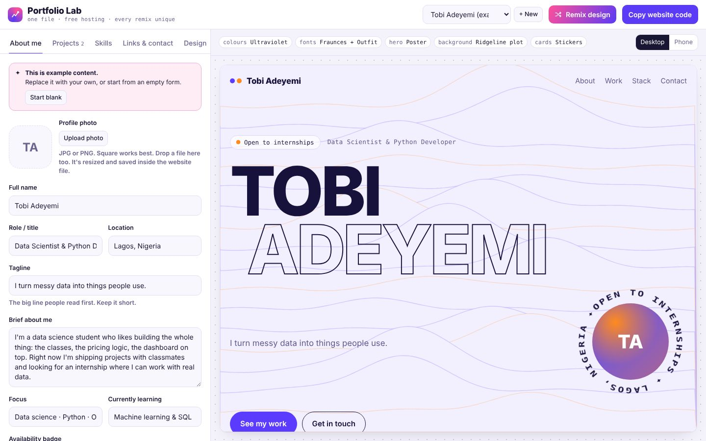
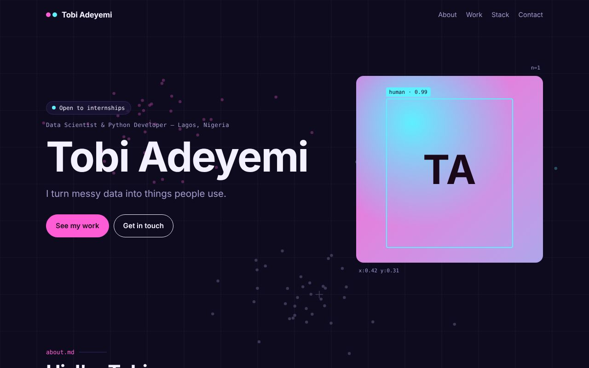
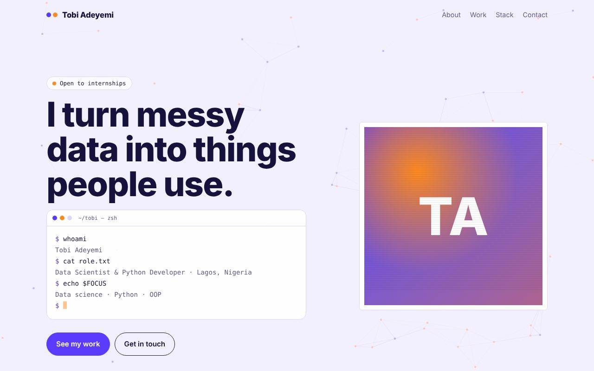
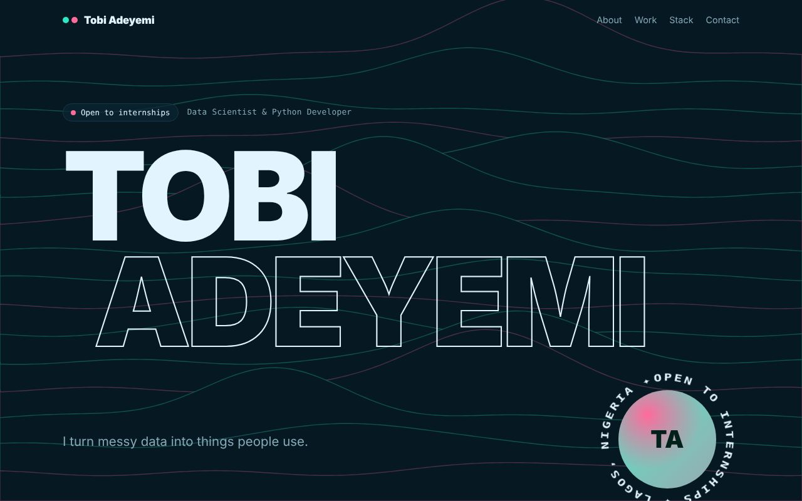
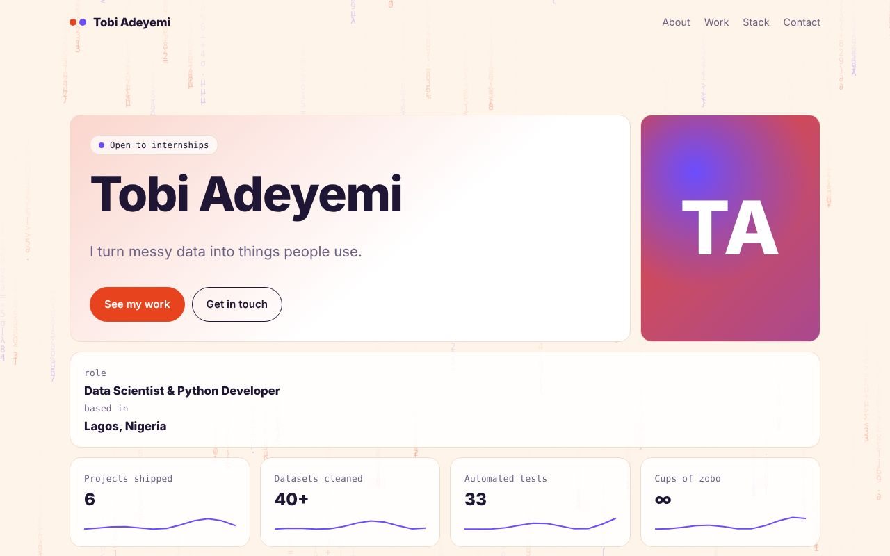
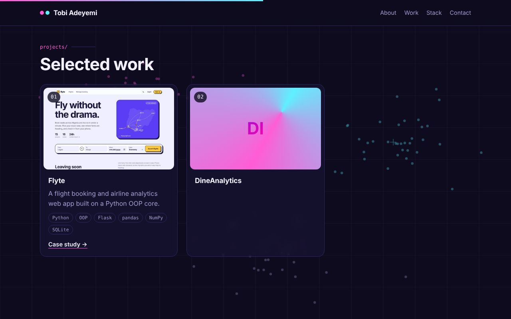
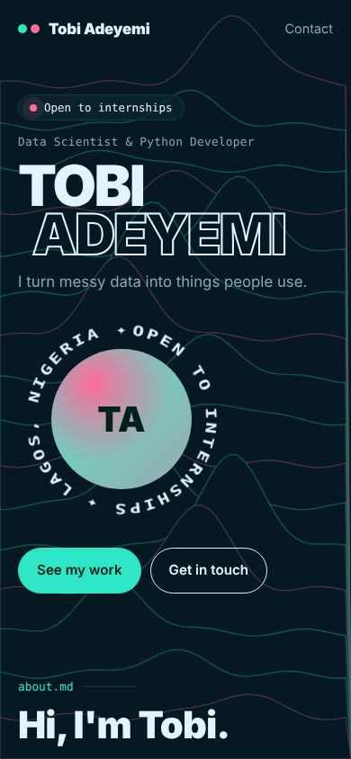
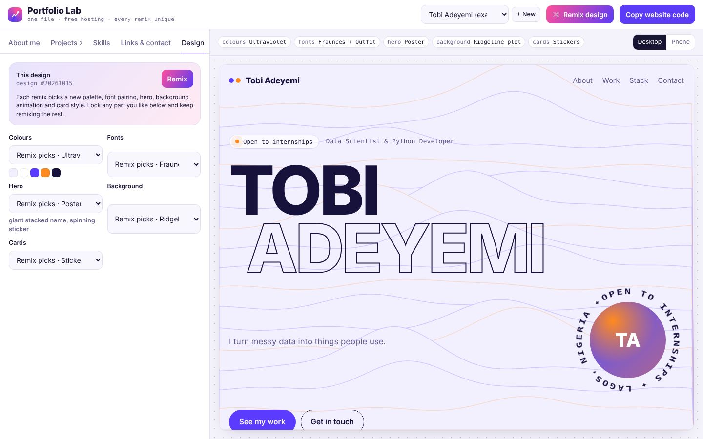

# Portfolio Lab

**Make a personal portfolio website in about ten minutes. Every remix gives you a different design.**

Portfolio Lab is a browser-based website builder for students and early-career developers, aimed at data
science and Python folks. You fill in a form (photo, bio, projects, skills, links) and watch your site build
live beside it. When you like it, you copy one file and host it for free on GitHub Pages.

**Live demo:** https://kevinsax.github.io/portfolio-lab/



## Every site is different

Each **Remix** combines 8 colour palettes × 7 font pairings × 4 hero layouts × 5 animated backgrounds × 4
card styles, which is over 4,000 distinct designs. You can lock any part you like and keep remixing the rest.

| | |
|---|---|
|  |  |
|  |  |

| Projects with case-study pop-ups | Works on phones | Design controls |
|---|---|---|
|  |  |  |

## Features

- **Live editor and preview** side by side, with desktop and phone preview sizes.
- **Photo and screenshot upload.** Images are resized in the browser and embedded in the site file, so there
  are no broken image links.
- **Projects** with screenshots, tags, code and demo links, and a "case study" pop-up (problem, what I did,
  results).
- **Skills as an animated bar chart,** plus a scrolling skills marquee.
- **Live GitHub section:** the published site calls the GitHub API to show your public repos, stars and a
  language donut chart.
- **Contact section** with copy-email, social links and an optional contact form (via FormSubmit, no
  backend needed).
- **Data-science look and motion:** animated canvas backgrounds (scatter clusters, neural network, ridgeline
  plot, data rain, live histogram), count-up stats, scroll reveals, card tilt and a scroll progress bar. All
  of it respects the "reduce motion" setting.
- **Multiple profiles,** so a teacher can build sites for several students, with backup and restore as JSON.
- **Private by design:** everything stays in your browser (localStorage). There is no server or account.

## How to use it

1. Open the [live demo](https://kevinsax.github.io/portfolio-lab/), or `index.html` locally.
2. Click **+ New** (or **Start blank** on the example) and fill in each tab.
3. Click **Remix** until you like the design.
4. Click **Copy website code**.
5. On GitHub, create a public repo named `your-username.github.io`, add a file called `index.html`, paste the
   code and commit.
6. Your site is live at `https://your-username.github.io` within a minute or two.

## How it works

No framework and no build step: plain HTML, CSS and JavaScript.

| File | Job |
|---|---|
| `index.html` | The editor's layout: tabs, form fields, preview frame |
| `css/maker.css` | The editor's styles, with light and dark themes |
| `js/designs.js` | The design system: palettes, font pairings, hero layouts, backgrounds, card styles |
| `js/example.js` | The example profile and empty-profile templates |
| `js/helpers.js` | Escaping, URL checks, a seeded random generator, and parsers for stats and skills |
| `js/site-builder.js` | `buildSite(profile)` turns a profile into a complete, self-contained HTML page |
| `js/site-runtime.js` | Code that runs on the *generated* site: animations, GitHub API, charts, pop-ups |
| `js/app.js` | The editor: form binding, image upload and resizing, projects, remix, preview, publish |

Some details worth noting:

- **Deterministic designs.** Each profile stores a numeric seed. A seeded random generator (mulberry32) turns
  the seed into design choices, so the same seed always gives the same site, and a remix is just a new seed.
- **One-file output.** The generated page inlines its CSS, JavaScript and images (as data URIs), so it can be
  hosted anywhere.
- **Safe output.** All user text is HTML-escaped, and links are restricted to `http(s)` and `mailto`.
- **Self-contained runtime.** `siteRuntime` is written as a normal function and copied into each generated
  page with `Function.prototype.toString()`, so the code that runs on published sites is still readable,
  testable JavaScript.

## Run it locally

```bash
git clone https://github.com/kevinsax/portfolio-lab.git
cd portfolio-lab
python -m http.server 8000      # then open http://localhost:8000
```

Opening `index.html` directly also works. The only difference is that the example project's screenshot
doesn't load from disk.

## Ideas for later

- Export a matching one-page PDF CV from the same profile.
- More hero layouts and background animations.
- Custom accent colour picker.
- Publish straight to GitHub from the editor (GitHub OAuth).

## Author

**Kevinsax** · [GitHub](https://github.com/kevinsax)

Built with AI-assisted development.

## License

MIT. See [LICENSE](LICENSE).
